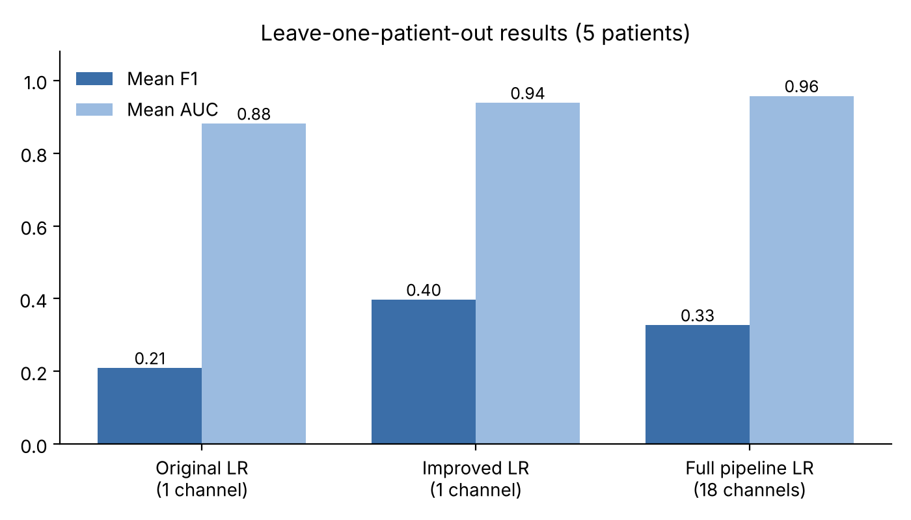
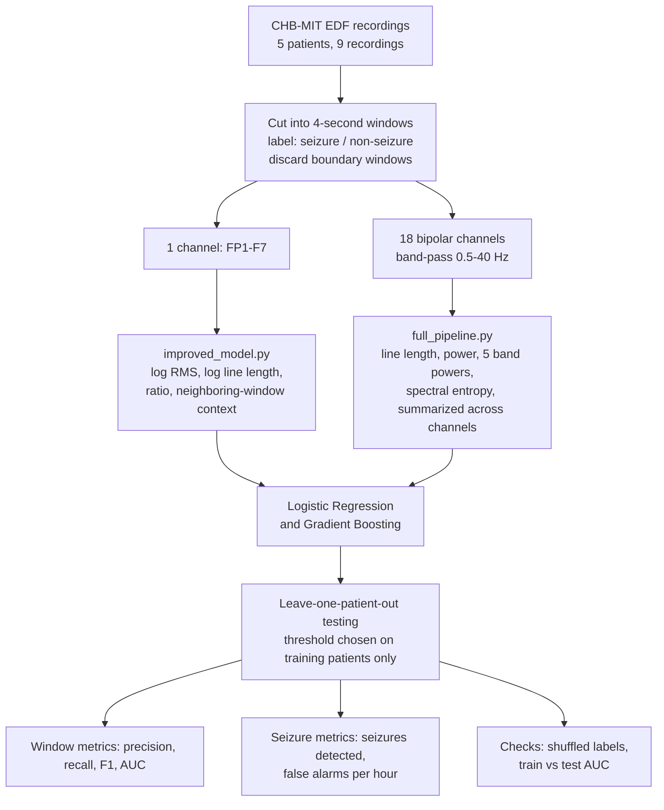

# Patient-Independent Seizure Detection from Scalp EEG

An offline machine-learning study that classifies 4-second scalp EEG windows as seizure or non-seizure. The model is always tested on a patient it has never seen. Data come from a subset of the CHB-MIT Scalp EEG Database (PhysioNet).

This is an educational project. It is not a clinical or real-time tool.



## Results

All numbers below come from leave-one-patient-out testing. Each of the 5 patients is held out once as the test patient, and the model is trained on the other 4. The decision threshold is chosen using the training patients only.

| Model | Channels | Features | Mean F1 | Mean AUC |
|---|---:|---|---:|---:|
| Original Logistic Regression | 1 | variance, RMS, line length | 0.21 | 0.88 |
| Improved Logistic Regression | 1 | log features + neighboring-window context | **0.40** | 0.94 |
| Full pipeline Logistic Regression | 18 | time and frequency features | 0.33 | **0.96** |

### Results per patient (leave-one-patient-out)

Each row is one held-out test patient. Values are F1 / AUC.

| Test patient | Original LR (1 channel) | Improved LR (1 channel) | Full pipeline LR (18 channels) |
|---|---:|---:|---:|
| chb01 | 0.356 / 0.976 | 0.118 / 0.998 | 0.118 / 0.997 |
| chb03 | 0.075 / 0.809 | 0.268 / 0.913 | 0.133 / 0.986 |
| chb05 | 0.279 / 0.956 | 0.814 / 0.992 | 0.306 / 0.931 |
| chb07 | 0.116 / 0.874 | 0.784 / 0.997 | 0.933 / 1.000 |
| chb08 | 0.220 / 0.787 | 0.000 / 0.792 | 0.147 / 0.870 |
| **Mean** | **0.209 / 0.881** | **0.397 / 0.938** | **0.327 / 0.957** |

Results vary strongly between patients. A single test patient is therefore not enough to judge a model.

On the original fixed split (test patient chb08), the full pipeline detected **both seizures** with **0.5 false alarms per hour**.

Accuracy is not reported. About 95% of windows are non-seizure, so a model that never predicts a seizure would still reach about 95% accuracy.

### How the results were checked

- **Unseen patients only.** No patient appears in both training and testing.
- **Nested threshold choice.** The cutoff is picked on the training patients and never on the test patient.
- **Shuffled-label check.** Labels are randomly shuffled and the full procedure is repeated. Mean AUC drops to about 0.52, which is chance level. This shows the pipeline does not leak information from the test data.
- **Train vs test gap.** For the improved 1-channel model, train AUC (0.94) and test AUC (0.94) are almost equal, so it does not overfit. The 18-channel model shows a larger gap (train AUC about 0.99), which is a sign of mild overfitting with 30 features and only 5 patients.

Full printed outputs are in `results/improved_model_results.txt` and `results/full_pipeline_results.txt`.

## Method




**Data.** Nine recordings from five CHB-MIT patients (chb01, chb03, chb05, chb07, chb08), sampled at 256 Hz. Each recording is cut into non-overlapping 4-second windows. Windows fully inside an annotated seizure are labeled 1 and windows fully outside are labeled 0. Windows that cross a seizure boundary are discarded. This gives 8,119 windows, of which 211 are seizure windows.

**Original model.** One channel (FP1-F7), three features (variance, RMS, line length), and Logistic Regression with balanced class weights.

**Improved model (`improved_model.py`).** Uses the same single channel and the same feature table.
- Log transform of RMS and line length, since EEG amplitudes are strongly skewed.
- Variance removed, because it is nearly RMS squared and made the coefficients unstable.
- Ratio of line length to RMS, a simple proxy for signal frequency.
- Averages over the 5 and 9 neighboring windows, since a seizure lasts much longer than one window.
- Light smoothing of predicted probabilities across 3 windows.
- Regularized Logistic Regression and a small gradient-boosted tree model.

**Full pipeline (`full_pipeline.py`).** Reads the raw EDF files.
- 18 standard bipolar channels, band-pass filtered at 0.5 to 40 Hz.
- Per channel: log line length, log power, relative power in the delta, theta, alpha, beta and gamma bands, and spectral entropy.
- Each feature is summarized across channels by median, maximum and standard deviation. The model therefore does not depend on where a seizure starts.
- Seizure-level evaluation: number of seizures detected and false alarms per hour.

Neighboring-window context uses windows both before and after the current one. This is valid for offline review but would need to be past-only for real-time use.

## Repository contents

```
eeg-seizure-detection/
├── README.md
├── REPORT.md            course report (sections 1-9 original, section 10 improved models)
├── requirements.txt
├── scripts/
│   ├── final_subset_metadata.py      recordings, seizure times, patient split
│   ├── final_feature_extraction.py   builds the 1-channel feature table from EDF files
│   ├── final_eda.py                  exploratory plots
│   ├── final_baseline.py             line-length threshold baseline
│   ├── final_logistic_regression.py  original Logistic Regression
│   ├── improved_model.py             improved 1-channel model + leave-one-patient-out
│   ├── full_pipeline.py              18-channel time and frequency pipeline
│   ├── final_results_table.py        results table for all models
│   └── final_results_plots.py        confusion matrices and comparison figure
├── results/
│   ├── final_features.csv            1-channel feature table (8,119 windows)
│   ├── final_results_table.csv
│   ├── improved_model_results.txt    printed output of improved_model.py
│   └── full_pipeline_results.txt     printed output of full_pipeline.py
└── figures/                          all plots
```

## How to run

```bash
pip install -r requirements.txt

# Works with the included final_features.csv, no raw data needed
python scripts/improved_model.py

# Needs the raw EDF files (see below)
python scripts/full_pipeline.py
```

### Getting the raw data

The EDF files are not included in this repository because of their size. Download them from the [CHB-MIT Scalp EEG Database](https://physionet.org/content/chbmit/1.0.0/) and place them as:

```
data/chb01/chb01_03.edf
data/chb01/chb01_04.edf
data/chb03/chb03_01.edf
...
```

The full list is in `scripts/final_subset_metadata.py`. Run all scripts from the main repository folder.

## Limitations

- Only 5 patients and 9 recordings, all of which contain seizures.
- The decision threshold does not transfer well between patients. Some patients reach an AUC near 0.99 but low recall at the chosen threshold.
- Precision stays low, so the models still produce many false-positive windows.
- Patient chb08 remains difficult for every model tested (AUC 0.80 to 0.87).
- Results are window-level and offline, and they are not evidence of clinical usefulness.

The clearest next step is to add more CHB-MIT patients to `scripts/final_subset_metadata.py`.

## Data citation

Shoeb AH. Application of Machine Learning to Epileptic Seizure Onset Detection and Treatment. PhD thesis, Massachusetts Institute of Technology, 2009.

Goldberger AL, Amaral LAN, Glass L, et al. PhysioBank, PhysioToolkit, and PhysioNet. Circulation. 2000;101(23):e215-e220.
